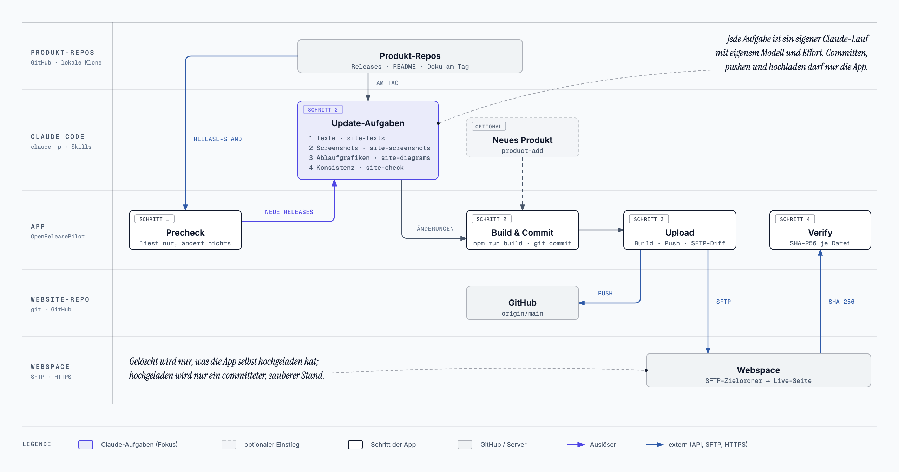

[English](README.md) · **Deutsch**


# OpenReleasePilot

Desktop-App, die eine statische Website auf dem Stand der Releases hält, die sie beschreibt,
und sie veröffentlicht: Claude Code aktualisiert die Inhalte, die App baut, committet, pusht und
lädt das Ergebnis per SFTP hoch und prüft danach die Live-Seite Byte für Byte.

Vier Schaltflächen, einzeln oder nacheinander:

| Schritt | Was passiert | Ändert etwas? |
|---|---|---|
| **Precheck** | Projektdatei, Werkzeuge (git, node, npm, claude, gh), sauberes Arbeitsverzeichnis und Remote-Stand, neuestes GitHub-Release jedes beobachteten Produkts gegen den dokumentierten Stand, SFTP-Anmeldung und Zielordner, Live-Seite, letzter Upload | nein |
| **Update** | `git pull --ff-only`, dann läuft Claude Code headless im Projekt mit dem Skill des Projekts und der Liste veralteter Produkte (plus optionaler Zusatzanweisung), danach Build und Commit | Dateien im Projekt, ein Commit |
| **Upload** | Frischer Build, `git push`, dann nur neue oder geänderte Dateien per SFTP; aus dem Build entfernte Dateien werden auf dem Server gelöscht | Server, Remote-Repository |
| **Verify** | Lädt jede Datei des letzten Uploads von der Live-Seite und vergleicht SHA-256 mit dem Build | nein |



<sub>Quelle der Grafik: [docs/diagrams/openreleasepilot-flow.de.html](docs/diagrams/openreleasepilot-flow.de.html) (auch als SVG).</sub>

**Neues Produkt** (Knopf in der Kopfleiste): eines deiner GitHub-Repositories wählen, Claude
Code nimmt es mit dem `addProductSkill` des Projekts auf (Produktseite, Listen, Icon, Ablaufgrafik,
Eintrag in `site.json`), danach baut und committet die App. Live geht es mit Upload.

## Produkte auswählen

Das Hauptfenster listet die Produkte aus `site.json` mit je einer Checkbox. Precheck und Update kümmern
sich nur um ausgewählte Produkte: Abgewählte fragt der Precheck nicht ab, und Claude bekommt sie beim
Update als „nicht ausgewählt, daran nichts ändern“ genannt. Jede Zeile zeigt den dokumentierten Stand,
nach einem Precheck auch, ob ein neueres Release vorliegt, und „kein Klon“, wenn `localPath` fehlt. Die
Auswahl merkt sich die App in ihren Einstellungen, nicht im Website-Repository.

## Repos pflegen

**Repos pflegen …** in der Kopfleiste arbeitet in den Repositories der ausgewählten Produkte, über die
angemeldete `gh`-CLI, in zwei Teilen:

1. **Prüfen** liest den Stand jedes Repositorys auf GitHub; danach bewertet Claude Code jeden offenen
   Pull Request, nur lesend (im lokalen Klon, wenn es einen gibt), nach den Regeln des Skills
   `dependabot-pr`: Risikoklasse (grün, gelb, rot; unter 1.0 zählt ein Wechsel der ersten Stelle ungleich
   null als Major), Release-Notes aus dem Original-Repository, bei Dependabot nur Manifest-, Lock- und
   Workflow-Dateien, SHA-Pins von Actions, zusammengehörige Abhängigkeiten nur gemeinsam, Majors gegen die
   tatsächliche Nutzung im Code. Was Claude sich ansieht, steht im Log.
2. Die Vorschau unter „Ergebnis“ zeigt pro Repository, was passiert, gruppiert: wird gemergt, wird
   geschlossen, Rebase, bleibt offen, jeweils mit Claudes Risiko und Begründung. **Ausführen** setzt sie
   um, **Verwerfen** verwirft sie. Jeder Punkt wird unmittelbar davor erneut geprüft; was sich seit der
   Vorschau geändert hat, bleibt unangetastet.

Was der Lauf tut:

- **Mergen:** nur Pull Requests auf den Hauptbranch, die GitHub als mergebar mit lauter grünen Checks
  meldet und die Claude grün einstuft, oder gelb ohne Relevantes in den Release-Notes. Rot wird nie
  gemergt, ohne Urteil wird nichts gemergt. Als Merge-Commit, wenn das Repository das erlaubt.
- **Schließen:** Pull Requests, die Claude für überflüssig hält (von einem neueren überholt, schon im
  Hauptbranch), mit der Begründung als Kommentar.
- **Rebase:** Dependabot-Pull-Requests mit Merge-Konflikt bekommen `@dependabot rebase`, auch wenn ein
  Merge desselben Laufs den Konflikt verursacht hat; ein späterer Lauf kann sie mergen.
- **Tag:** die nächste Patch-Version des neuesten `x.y.z`-Tags (mit dem `tagPrefix` des Produkts), erst
  wenn die CI auf dem Hauptbranch nach den Merges grün ist (die App wartet bis zu 30 Minuten; rote CI
  heißt kein Tag). In Repositories mit Release-Workflow startet der Tag ein Release.
- **Gemergte Branches löschen** (optional): Branches, deren Commits vollständig im Hauptbranch sind oder
  deren Pull Request gemergt wurde (auch per Squash), auf GitHub und im lokalen Klon (nach
  `git fetch --prune`). Hauptbranch, geschützte Branches, Branches offener Pull Requests und der
  ausgecheckte Branch bleiben.

Die Prüfung kostet Claude-Nutzung, je nach Modell und Zahl der Pull Requests einige Cent bis etwa einen
Dollar pro Repository.

## Repositories wählen

Die App listet deine GitHub-Repositories über die angemeldete `gh`-CLI, auch private, und markiert
jedes: lokaler Klon gefunden, schon auf der Seite, Website-Repository. Ohne `gh`-Anmeldung zeigt sie die
öffentlichen Repositories der Besitzer, die schon auf der Seite stehen.

- **Website-Repo** (Einrichtung): aus der Liste wählen; der Projektordner ergibt sich aus dem lokalen
  Klon. Gibt es keinen, klont die App das Repo in den Repo-Ordner.
- **Repo-Ordner** (Einrichtung): hier werden lokale Klone gesucht und angelegt; standardmäßig der
  Elternordner des Projektordners. Dort gefundene Produkt-Klone bekommt Claude als `localPath`.

## Installation

`OpenReleasePilot-<version>.pkg` aus den
[Releases](https://github.com/bl0rb/OpenReleasePilot/releases) laden (Apple Silicon) und mit der
`.sha256`-Datei daneben prüfen:

```bash
shasum -a 256 -c OpenReleasePilot-*.pkg.sha256
```

Das Paket installiert `OpenReleasePilot.app` nach `/Applications` und ersetzt eine installierte Version.
Es ist nicht signiert, macOS blockiert es deshalb beim ersten Öffnen; einmal unter **Systemeinstellungen →
Datenschutz & Sicherheit → Dennoch öffnen** erlauben oder im Terminal installieren:

```bash
sudo installer -pkg OpenReleasePilot-0.2.2.pkg -target /
```

Dasselbe Paket lässt sich über Microsoft Intune als „macOS-App (PKG)“ verteilen; dann in der
Einrichtung „Beim Start nach neuen Versionen suchen“ abschalten.

Bis Version 0.1.3 hieß die App OpenFTPUpdater-AI. OpenReleasePilot ersetzt `OpenFTPUpdater-AI.app`
nicht; die alte App nach dem Umstieg löschen (Einstellungen und Passwort werden übernommen, siehe unten).

## Updates der App

Wie bei ClaudeKeyZapper: Beim Start fragt die App einmal still das neueste Release dieses Repositories
auf GitHub ab; manuell geht es über **Nach Updates suchen** in der Fußzeile. Ist eine neuere Version da,
erscheint oben ein Banner. **Installieren** lädt die `.pkg` von `github.com`, prüft sie gegen die
SHA-256-Prüfsumme, die GitHub für das Release-Asset veröffentlicht, und gegen die minisign-Signatur des
Releases (`<Paket>.minisig`, geprüft mit dem in die App eingebauten öffentlichen Schlüssel,
[desktop/update-key.pub](desktop/update-key.pub)) und öffnet den macOS-Installer; ohne Prüfsumme oder
gültige Signatur wird abgelehnt; danach die App neu starten. Beta-Versionen (`X.Y.Z-beta.N`) gibt es nur über
**Beta-Version suchen** oder wenn schon eine Beta installiert ist. Entwicklungs-Builds prüfen nicht.

## Voraussetzungen

- macOS (entwickelt unter macOS 27; der Code ist plattformübergreifendes Tauri, Windows ist ungetestet)
- Auf dem Rechner: `git`, Node.js/npm (für den Build der Seite), angemeldetes [Claude Code](https://claude.com/claude-code), empfohlen die angemeldete GitHub-CLI `gh` (hebt das GitHub-API-Limit von 60 auf 5000 Anfragen pro Stunde; das Token geht auch als `GITHUB_TOKEN` an den Build, den die App ausführt, aber nie an Claude Code)
- Ein SFTP-Zugang zum Webspace

Die App startet aus dem Finder und fragt einmal die Login-Shell nach dem `PATH`, damit
Werkzeuge aus nvm, Homebrew oder `~/.local/bin` gefunden werden.

## Projektdatei `.openreleasepilot/site.json`

Liegt im Website-Repository und beschreibt Build und beobachtete Produkte. Projekte, die vor der
Umbenennung von OpenFTPUpdater-AI eingerichtet wurden, behalten ihre `.openftpupdater/site.json`; sie
wird gelesen, solange die neue Datei fehlt.

```json
{
  "name": "example.com",
  "url": "https://example.com",
  "build": "npm run build",
  "output": "dist",
  "addProductSkill": "product-add",
  "tasks": [
    { "id": "texts", "label": "Texte", "skill": "site-texts", "effort": "high" },
    { "id": "screenshots", "label": "Screenshots", "skill": "site-screenshots", "effort": "medium" }
  ],
  "failOnOutput": ["[releases]"],
  "products": [
    { "id": "app", "name": "App", "repo": "owner/app", "tagPrefix": "v", "documented": "1.2.0", "localPath": "../app" }
  ],
  "claude": {
    "model": "opus",
    "effort": "high",
    "maxBudgetUsd": 15,
    "allowedTools": ["Bash(node scripts/screenshots/*)"],
    "disallowedTools": []
  }
}
```

| Feld | Bedeutung |
|---|---|
| `url` | Öffentliche Adresse; dort liegt die Wurzel der Build-Ausgabe (für Precheck und Verify) |
| `build`, `output` | Build-Befehl (läuft mit `/bin/sh -c` im Projekt) und sein Ausgabeordner (ein Unterordner des Projekts: kein absoluter Pfad, kein `..`) |
| `tasks` | Update-Aufgaben, in der App als Häkchen wählbar; je Aufgabe `id`, `label`, `skill` (`.claude/skills/<name>/SKILL.md`), optional `description`, `default` (gewählt, solange nicht abgewählt; Standard `true`), `model` und `effort` |
| `skill` | Einzelner Update-Skill für Seiten ohne `tasks` |
| `addProductSkill` | Claude-Code-Skill, der ein Repository als neues Produkt aufnimmt |
| `failOnOutput` | Zeilen der Build-Ausgabe, die den Build trotz Exit-Code 0 scheitern lassen, z. B. eine Warnung, dass Versionen auf alte Werte zurückgefallen sind |
| `products[].repo` | GitHub-Repository, dessen neuestes Release (ohne Pre-Releases) beobachtet wird |
| `products[].documented` | Release, den die Inhalte beschreiben; der Skill setzt ihn nach dem Update hoch |
| `products[].tagPrefix` | `v` bei Tags wie `v1.2.0`, leer bei `1.2.0` |
| `products[].localPath` | Lokaler Klon relativ zum Projekt; Claude liest ihn über `git -C`, ändert ihn nie |
| `claude.model`, `claude.effort` | Standard-Modell-Alias (`opus`, `sonnet`, `haiku`, `fable`) und Effort (`low` … `max`) für jeden Claude-Lauf |
| `claude.maxBudgetUsd` | Kostengrenze je Claude-Lauf (`--max-budget-usd`) |
| `claude.allowedTools` | Ergänzt die Freigabeliste der App (siehe unten); CLI-Flags und ein uneingeschränktes `Bash` werden abgelehnt |

Das eigentliche Wissen steckt im Skill: wo die Produkttexte stehen, wie Screenshots entstehen,
welche Aussagen nie gemacht werden dürfen. Claude liest ihn bei jedem Update.

## Update-Aufgaben und Modelle

Jede gewählte Aufgabe läuft als eigene Claude-Code-Sitzung, in der Reihenfolge von `tasks`, mit
eigenem Skill, Modell und Effort; die App committet am Ende einmal. Kleine Aufgaben-Skills halten
jeden Lauf fokussiert, und Regeln für alle (Quellen, Stil, was nie behauptet werden darf) gehören in
die `CLAUDE.md` des Projekts, die Claude Code bei jedem Lauf liest. In der App hat jede Aufgabe ein
Häkchen und eine Modellwahl; beides bleibt gespeichert.

Das Modell ist ein Claude-Code-Alias, der auf das neueste Modell seiner Familie zeigt, soweit das
installierte Claude Code es kennt. Deshalb führt die App vor Claude-Läufen `claude update` aus
(höchstens alle sechs Stunden); das Log zeigt die Version und am Anfang jedes Laufs das genaue Modell:

| Alias | Modell (Okt. 2026) | API-Preis je 1 Mio. Token (Eingabe / Ausgabe) | Einsatz |
|---|---|---|---|
| `opus` | Claude Opus 5.5 | 4 $ / 20 $ | Standard: öffentliche Produktaussagen in zwei Sprachen brauchen Genauigkeit |
| `sonnet` | Claude Sonnet 5.5 | 2 $ / 10 $ | Einen Versuch wert bei mechanischen Aufgaben wie Screenshots und Grafiken |
| `haiku` | Claude Haiku 4.5 | 1 $ / 5 $ | Kleine, klar per Skript vorgegebene Aufgaben |
| `fable` | Claude Fable 5.1 | 10 $ / 50 $ | Nur wenn Opus nicht reicht, etwa bei einer neuen Produktseite |

Effort ist der erste Hebel: `high` für Texte und Konsistenzprüfung, `medium` für Screenshots und
Grafiken. Bei Anmeldung mit einem Claude-Abo sind die angezeigten Kosten ein rechnerischer API-Preis;
die Läufe zählen stattdessen gegen die Nutzungsgrenzen des Abos.

## Was Claude darf

Claude Code läuft als `claude -p … --permission-mode acceptEdits` im Projektordner. Ein
Headless-Lauf kann nicht nachfragen, alles außerhalb der Freigabeliste wird abgelehnt:

- Dateien im Projekt lesen, durchsuchen, bearbeiten und schreiben; Skills nutzen
- git nur lesend, im Projekt und in anderen Repositories über `git -C <Pfad> log|show|diff|tag|describe|ls-tree|fetch --tags`
- `gh release list|view`, `grep`, `ls`, der Build-Befehl des Projekts
- was `claude.allowedTools` in site.json ergänzt

Immer abgelehnt: `git push`, `git commit`, `git reset`, `git checkout`, `rm`. Committen,
pushen und hochladen macht die App. Abgelehnte Aufrufe stehen nach dem Lauf in der Übersicht,
damit die Freigabeliste bewusst erweitert werden kann.

Claude bekommt kein `GITHUB_TOKEN`. Nach jedem Lauf lädt die App `site.json` neu und stoppt vor Build,
Commit und Upload, wenn sich `build`, `output` oder `claude.allowedTools`/`disallowedTools` geändert
haben; ein Lauf kann seine eigenen Rechte so nicht erweitern. Neue Produkte anlegen ist davon nicht
betroffen.

## Upload

- Das Passwort (oder die Passphrase eines Schlüssels) liegt im Schlüsselbund des Systems, nie in
  einer Datei oder im Repository. SSH-Schlüssel werden ebenfalls unterstützt.
- Der Server-Schlüssel wird einmal bestätigt (`SHA256:…`, vergleichen mit
  `ssh-keyscan -p 22 host | ssh-keygen -lf -`); ändert er sich später, bricht jede Verbindung ab.
- Die App merkt sich je Ziel ein Manifest des letzten Uploads (Pfad, Größe, SHA-256) in ihrem
  Datenordner. Hochgeladen werden nur neue oder geänderte Dateien, Assets vor Seiten, jeweils unter
  einem temporären Namen und dann umbenannt, damit Besucher nie halbe Dateien bekommen. Gelöscht
  werden nur Dateien, die die App selbst hochgeladen hat; andere Dateien auf dem Server (andere
  Domains, `.htaccess`, …) bleiben unberührt.
- Hochgeladen wird nur ein committeter, sauberer Stand, und nur wenn er nicht hinter `origin` liegt.

Die Einstellungen liegen in `~/Library/Application Support/OpenReleasePilot/config.json` (ohne Geheimnisse).
Beim ersten Start nach der Umbenennung übernimmt die App den Ordner `OpenFTPUpdater-AI` und das unter
dem alten Namen gespeicherte SFTP-Passwort; macOS fragt dabei unter Umständen einmal, ob
OpenReleasePilot diesen Schlüsselbundeintrag verwenden darf.

## Bauen

```bash
cd desktop
npm ci
npm run build
```

Die App liegt danach unter `desktop/target/release/bundle/macos/OpenReleasePilot.app`
(ad-hoc signiert). Während der Entwicklung: `npm run dev`. Tests des Kerns:
`cargo test -p openreleasepilot-core`.

`scripts/build-pkg.sh` baut den Installer wie die CI: `dist/OpenReleasePilot-<version>.pkg` mit
`.sha256`-Datei (`VERSION=0.2.0 scripts/build-pkg.sh`). `SIGN_IDENTITY` (Developer ID Application) und
`INSTALLER_IDENTITY` (Developer ID Installer) signieren App und Paket; ohne sie ist die App ad-hoc
signiert und das Paket unsigniert.

`bundle.macOS.minimumSystemVersion` ist bewusst nicht gesetzt: Mit
`MACOSX_DEPLOYMENT_TARGET=14.0` erzeugte Rust 1.94 unter macOS 27 im Release-Build
Proc-Macro-Bibliotheken, die sich nicht laden ließen („mis-aligned LINKEDIT string pool“).

```
desktop/core       Rust-Bibliothek: Einstellungen, site.json, Shell/PATH, git, GitHub, Claude, SFTP, Manifest, Verify
desktop/src-tauri  Tauri-App: Zustand, Befehle, die vier Schritte
desktop/ui         Web-Oberfläche (HTML, JS, CSS), ohne Build-Schritt
```

## CI und Releases

- `.github/workflows/ci.yml`: Jeder Pull Request und jeder Push auf `main` führt die Tests des Kerns und
  den Release-Build aus (`build.yml`, macOS 15, Apple Silicon).
- `.github/workflows/release.yml`: Ein Tag `X.Y.Z` (oder `X.Y.Z-beta.N` für ein Pre-Release) baut mit
  dieser Version, signiert die `.pkg` mit minisign und veröffentlicht ein GitHub-Release mit `.pkg`,
  Prüfsumme und `.minisig`. Veröffentlicht wird erst nach grünen Tests und grünem Build, und nur mit dem
  Repository-Secret `MINISIGN_SECRET_KEY` (der geheime Schlüssel zu `desktop/update-key.pub`); ohne
  Secret bricht der Workflow ab, statt einen unsignierten Installer zu veröffentlichen.
- Alle Actions sind auf Commit-SHAs gepinnt (Version als Kommentar); Dependabot schlägt jeden Montag
  Updates für Actions, Crates und die Tauri-CLI vor.

```bash
git tag 0.2.0 && git push origin 0.2.0
```

## Lizenz

[MIT](LICENSE) © 2026 bl0rb
