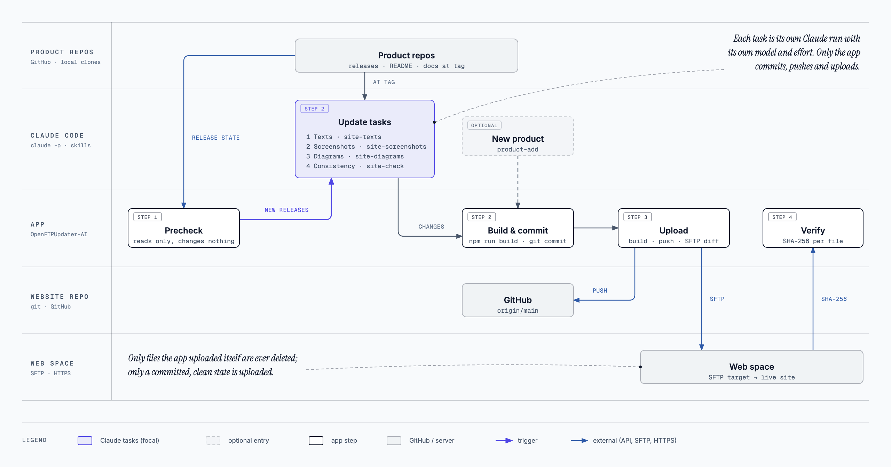

**English** · [Deutsch](README.de.md)


# OpenFTPUpdater-AI

Desktop app that keeps a static website in step with the releases of the products it
describes, and publishes it: Claude Code updates the content, the app builds, commits,
pushes and uploads the result via SFTP, then checks the live site byte for byte.

Four buttons, run one by one or all in a row:

| Step | What happens | Changes anything? |
|---|---|---|
| **Precheck** | Project file, tools (git, node, npm, claude, gh), clean working tree and remote state, latest GitHub release of every watched product against the documented one, SFTP login and target folder, live site, last upload | no |
| **Update** | `git pull --ff-only`, then Claude Code runs headless in the project with the project's skill and the list of outdated products (plus optional extra instructions), then build and commit | files in the project, one commit |
| **Upload** | Fresh build, `git push`, then only new or changed files via SFTP; files removed from the build are deleted on the server | server, remote repository |
| **Verify** | Downloads every file of the last upload from the live site and compares SHA-256 with the build | no |



<sub>Diagram source: [docs/diagrams/openftpupdater-flow.html](docs/diagrams/openftpupdater-flow.html) (also as SVG).</sub>

**New product** (button in the toolbar): pick one of your GitHub repositories, and Claude
Code adds it to the site with the project's `addProductSkill` (product page, listings, icon, diagram,
`site.json` entry), then the app builds and commits. It goes live with Upload.

## Selecting products

The main window lists the products from `site.json` with a checkbox each. Precheck and Update only
handle selected products: Precheck does not look up the others, and Update names them to Claude as "not
selected, leave unchanged". Every row shows the documented version, after a Precheck also whether a newer
release exists, and "kein Klon" if `localPath` is missing. The selection is stored in the app's settings,
not in the website repository.

## Choosing repositories

The app lists your GitHub repositories through the signed-in `gh` CLI, private ones included, and marks
each one: local clone found, already on the site, website repository. Without a `gh` login it falls back
to the public repositories of the owners already on the site.

- **Website repository** (Settings): pick it from the list; the project folder follows from its local
  clone. If there is none, the app clones it into the repo folder.
- **Repo folder** (Settings): where local clones are searched and created; by default the parent of the
  project folder. Product clones found there are handed to Claude as `localPath`.

## Installation

Download `OpenFTPUpdater-AI-<version>.pkg` from the
[releases](https://github.com/bl0rb/OpenFTPUpdater-AI/releases) (Apple silicon) and check it against the
`.sha256` file next to it:

```bash
shasum -a 256 -c OpenFTPUpdater-AI-*.pkg.sha256
```

The package installs `OpenFTPUpdater-AI.app` to `/Applications` and replaces an installed version. It is
not signed, so macOS blocks it on the first open; allow it once under **System Settings → Privacy &
Security → Open Anyway**, or install it in the terminal:

```bash
sudo installer -pkg OpenFTPUpdater-AI-0.1.3.pkg -target /
```

The same package can be distributed through Microsoft Intune as a "macOS app (PKG)"; then turn off
"Beim Start nach neuen Versionen suchen" in the settings.

## App updates

As in ClaudeKeyZapper: at start, the app quietly looks up the latest release of this repository on
GitHub once; **Nach Updates suchen** in the footer checks manually. If a newer version exists, a banner
appears at the top. **Installieren** downloads the `.pkg` from `github.com`, checks it against the SHA-256
digest GitHub publishes for the release asset and against the release's minisign signature
(`<package>.minisig`, verified with the public key built into the app,
[desktop/update-key.pub](desktop/update-key.pub)), and opens the macOS installer; without a digest or a
valid signature the update is refused; restart the app afterwards. Betas (`X.Y.Z-beta.N`) are only offered through **Beta-Version
suchen** or when a beta is installed. Development builds do not check.

## Requirements

- macOS (developed on macOS 27; the code is cross-platform Tauri, Windows is untested)
- On the machine: `git`, Node.js/npm (for the site build), [Claude Code](https://claude.com/claude-code) signed in, recommended the GitHub CLI `gh` signed in (raises the GitHub API limit from 60 to 5000 requests per hour; the token is also handed to the build the app runs as `GITHUB_TOKEN`, but never to Claude Code)
- An SFTP account for the web space

The app starts from the Finder and asks the login shell for the user's `PATH` once, so tools
installed with nvm, Homebrew or into `~/.local/bin` are found.

## Project file `.openftpupdater/site.json`

Lives in the website repository and describes how to build and what to watch:

```json
{
  "name": "example.com",
  "url": "https://example.com",
  "build": "npm run build",
  "output": "dist",
  "addProductSkill": "product-add",
  "tasks": [
    { "id": "texts", "label": "Texts", "skill": "site-texts", "effort": "high" },
    { "id": "screenshots", "label": "Screenshots", "skill": "site-screenshots", "effort": "medium" }
  ],
  "failOnOutput": ["[releases]"],
  "products": [
    { "id": "app", "name": "App", "repo": "owner/app", "tagPrefix": "v", "documented": "1.2.0", "localPath": "../app" }
  ],
  "claude": {
    "model": "opus",
    "effort": "high",
    "maxBudgetUsd": 15,
    "allowedTools": ["Bash(node scripts/screenshots/*)"],
    "disallowedTools": []
  }
}
```

| Field | Meaning |
|---|---|
| `url` | Public URL; the build output root is served there (used by Precheck and Verify) |
| `build`, `output` | Build command (run with `/bin/sh -c` in the project) and its output folder (a subfolder of the project: no absolute path, no `..`) |
| `tasks` | Update tasks, offered as checkboxes in the app; each has `id`, `label`, `skill` (`.claude/skills/<name>/SKILL.md`), optional `description`, `default` (selected unless turned off, default `true`), `model` and `effort` |
| `skill` | Single update skill for sites without `tasks` |
| `addProductSkill` | Claude Code skill that adds a repository as a new product |
| `failOnOutput` | Build output lines that fail the build even with exit code 0, e.g. a warning that versions fell back to stale values |
| `products[].repo` | GitHub repository whose latest release (no pre-releases) is watched |
| `products[].documented` | Release the site content describes; the skill raises it after updating |
| `products[].tagPrefix` | `v` for tags like `v1.2.0`, empty for `1.2.0` |
| `products[].localPath` | Local clone, relative to the project; Claude reads it through `git -C`, never edits it |
| `claude.model`, `claude.effort` | Default model alias (`opus`, `sonnet`, `haiku`, `fable`) and effort (`low` … `max`) for every Claude run |
| `claude.maxBudgetUsd` | Cost limit per Claude run (`--max-budget-usd`) |
| `claude.allowedTools` | Added to the app's allowlist (see below); CLI flags and an unrestricted `Bash` are rejected |

The skill is the actual know-how: where the product texts live, how screenshots are made,
which statements must never be made. Claude reads it on every update.

## Update tasks and models

Each selected task runs as its own Claude Code session, in the order of `tasks`, with its own skill,
model and effort; the app commits once at the end. Small task skills keep each run focused, and rules
that apply to all of them (sources, style, what must never be claimed) belong in the project's
`CLAUDE.md`, which Claude Code reads on every run. In the app, every task has a checkbox and a model
choice; both are remembered.

The model is a Claude Code alias that always points to the newest model of its family:

| Alias | Model (Oct 2026) | API price per 1M tokens (input / output) | Use |
|---|---|---|---|
| `opus` | Claude Opus 5.5 | $4 / $20 | Default: public product claims in two languages need accuracy |
| `sonnet` | Claude Sonnet 5.5 | $2 / $10 | Worth trying for mechanical tasks such as screenshots and diagrams |
| `haiku` | Claude Haiku 4.5 | $1 / $5 | Small, clearly scripted tasks |
| `fable` | Claude Fable 5.1 | $10 / $50 | Only if Opus results fall short, e.g. for a new product page |

Effort is the first lever: `high` for texts and the consistency check, `medium` for screenshots and
diagrams. With a Claude subscription login, the cost shown per run is a notional API price; the runs
count against the subscription's usage limits instead.

## What Claude may do

Claude Code runs as `claude -p … --permission-mode acceptEdits` in the project folder. Headless
runs cannot ask, so everything not on the allowlist is denied:

- read, search, edit and write files in the project; use skills
- read-only git in the project and in other repositories via `git -C <path> log|show|diff|tag|describe|ls-tree|fetch --tags`
- `gh release list|view`, `grep`, `ls`, the project's build command
- whatever `claude.allowedTools` in site.json adds

Always denied: `git push`, `git commit`, `git reset`, `git checkout`, `rm`. Committing, pushing
and uploading are the app's job. Denied tool calls are listed after the run, so the allowlist can
be extended deliberately.

Claude gets no `GITHUB_TOKEN`. After every run the app reloads `site.json` and stops before build,
commit and upload if `build`, `output` or `claude.allowedTools`/`disallowedTools` changed, so a run
cannot widen its own rights; adding products is not affected.

## Upload

- The password (or key passphrase) is stored in the system keychain, never in a file or repository.
  SSH keys are supported as well.
- The server's host key is confirmed once (`SHA256:…`, compare with `ssh-keyscan -p 22 host | ssh-keygen -lf -`);
  if it changes later, every connection stops.
- The app keeps a manifest of the last upload (path, size, SHA-256) per target in its data folder.
  It uploads only new or changed files, assets before pages, each to a temporary name and then
  renamed, so visitors never get half-written files. It deletes only files that it uploaded itself
  before; other files on the server (other domains, `.htaccess`, …) are never touched.
- Only a committed, clean working tree is uploaded, and only if it is not behind `origin`.

Settings live in `~/Library/Application Support/OpenFTPUpdater-AI/config.json` (no secrets).

## Building

```bash
cd desktop
npm ci
npm run build
```

`scripts/build-pkg.sh` builds the installer as CI does: `dist/OpenFTPUpdater-AI-<version>.pkg` with a
`.sha256` file (`VERSION=0.2.0 scripts/build-pkg.sh`). `SIGN_IDENTITY` (Developer ID Application) and
`INSTALLER_IDENTITY` (Developer ID Installer) sign app and package; without them the app is ad-hoc signed
and the package unsigned.

## Continuous integration and releases

- `.github/workflows/ci.yml`: every pull request and every push to `main` runs the core tests and the
  release build (`build.yml`, macOS 15, Apple silicon).
- `.github/workflows/release.yml`: a tag `X.Y.Z` (or `X.Y.Z-beta.N` for a pre-release) runs the same
  build with that version, signs the `.pkg` with minisign and publishes a GitHub release with the
  `.pkg`, its checksum and its `.minisig`. Publishing only starts after tests and build are green, and
  needs the repository secret `MINISIGN_SECRET_KEY` (the secret key matching `desktop/update-key.pub`);
  without it the workflow stops instead of publishing an unsigned installer.
- All actions are pinned to commit SHAs (version as a comment); Dependabot proposes updates for actions,
  crates and the Tauri CLI every Monday.

```bash
git tag 0.2.0 && git push origin 0.2.0
```

The app ends up in `desktop/target/release/bundle/macos/OpenFTPUpdater-AI.app` (ad-hoc signed).
During development: `npm run dev`. Core tests: `cargo test -p openftpupdater-core`.

`bundle.macOS.minimumSystemVersion` is deliberately unset: with `MACOSX_DEPLOYMENT_TARGET=14.0`,
Rust 1.94 on macOS 27 produced proc-macro libraries that fail to load in release builds
("mis-aligned LINKEDIT string pool").

```
desktop/core       Rust library: config, site.json, shell/PATH, git, GitHub, Claude, SFTP, manifest, verify
desktop/src-tauri  Tauri app: state, commands, the four steps
desktop/ui         Web UI (HTML, JS, CSS), no build step
```

## License

[MIT](LICENSE) © 2026 bl0rb
